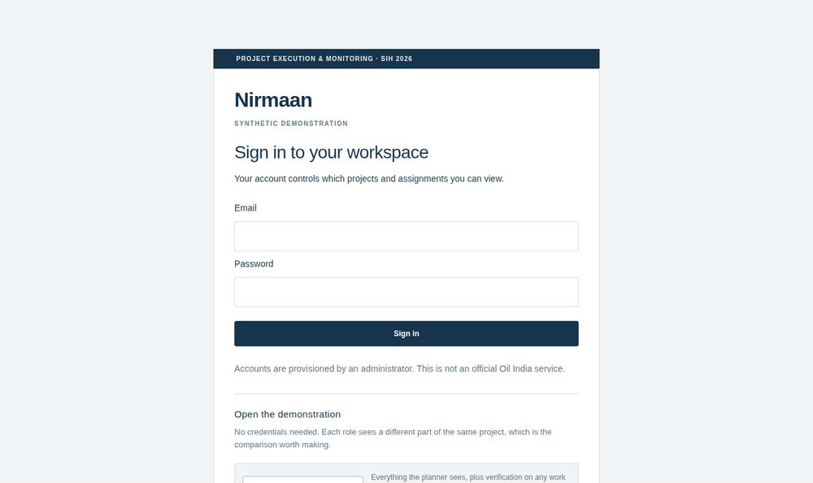

<div align="center">


### Turn what a supervisor says on site into a schedule update somebody signed for.

[](https://intelligrid-sih122.vercel.app/login)
[](https://youtu.be/mEQVCm0IRXY)

[](https://nextjs.org)
[](https://react.dev)
[](https://www.typescriptlang.org)
[](https://supabase.com)
[](https://nodejs.org)
[](#verification)
[](https://github.com/ShivenduShivu/SIH122/actions/workflows/checks.yml)

</div>

---

## The problem

On an EPC site, work happens in sentences. _"Spool erection on the 24-inch line finished today, two joints still pending NDT."_

That sentence has to become a dated row in a schedule a contractor eventually gets paid against. Today a planner retypes it, guesses what it matched, and the schedule drifts from the site a little more every week.

Automating the typing is the easy part. **The hard part is that a wrong guess is worse than no guess** — it writes a false actual date into a commercial record.

## What Nirmaan does

It reads the report, proposes a match against the planned activity, shows the reasoning, and then **stops**. A human accepts or rejects. Nothing reaches the schedule without a name against it.

<div align="center">



</div>

|                                      |                                                                                                                                        |
| ------------------------------------ | -------------------------------------------------------------------------------------------------------------------------------------- |
| 🗣️ **Report in plain words**         | Speak, type or photograph. Hindi, English or a mix. No forms, no activity codes to memorise.                                           |
| 🔍 **Evidence, not a score**         | Every proposed match shows the location, stage, discipline and quote it came from. The planner checks reasoning, not a confidence bar. |
| ✋ **Refuses to guess**              | When two activities fit equally well, the claim stops and the planner asks the reporter a specific question.                           |
| 🔐 **Authorisation in the database** | Row-level security and `SECURITY DEFINER` functions. The web app holds no privileged key and cannot bypass a policy.                   |
| 📜 **Append-only history**           | Who accepted what, when, against which schedule revision and policy version.                                                           |
| 📤 **Hands back to the planner**     | Exchange package of activity rows, evidence and exceptions, with a hash manifest.                                                      |

## See it yourself

**[intelligrid-sih122.vercel.app](https://intelligrid-sih122.vercel.app/login)** — four buttons, no credentials, no sign-up.

| Open as             | What that role can do                                                                                                                       |
| ------------------- | ------------------------------------------------------------------------------------------------------------------------------------------- |
| **Project manager** | Everything the planner sees, plus verification on any work front. The only role that can order a fresh check after a supervisor denies one. |
| **Planner**         | Schedule, review queue, assignments and exports. Accepts or rejects every reported event.                                                   |
| **Supervisor**      | Independently confirms work, limited to their own contractor, disciplines and work fronts. Cannot assign work.                              |
| **Field reporter**  | Submits progress from the site and sees only the work assigned to them.                                                                     |

Opening each in turn is the quickest way to see the point: one project, four genuinely different views, enforced in Postgres rather than in the interface.

> Synthetic project data only. Those sign-ins are published deliberately — treat anything recorded there as public.

<div align="center">


</div>

## The data was supplied, not invented

Oil India answered our SIH 26122 questions with three workbooks: an L4–L6 construction schedule, an L3 schedule and a field-input corpus. They describe a conceptual garbage-treatment plant, not a live project.

We parse them unmodified — source row values and formula caches preserved, never recalculated or rewritten. The running demonstration carries **149 reporting activities** and **147 claims across 83 reports** drawn from that corpus.

## How it is put together

```
apps/web            Next.js planner and field interfaces · 36 API routes
apps/worker         leased extraction and matching jobs · holds the private keys
packages/domain     pure matching rules · no React, no database, no model calls
packages/contracts  runtime-validated shapes shared by both ends
packages/adapters   providers, transcription, workbook import
supabase/           15 migrations · 34 tables · every one RLS-enabled
```

Three decisions worth knowing about:

**Authorisation lives in Postgres, not the application.** All 34 tables have row-level security enabled, and all 69 `SECURITY DEFINER` functions pin `search_path`. The web server only ever uses the signed-in user's session and the publishable key; the service-role key exists solely in the worker.

**The language model extracts; it never decides.** It turns prose into candidate facts. Ranking against the plan is a reviewed, hand-weighted scorer in `packages/domain`, and acceptance is a human action written to an append-only table.

**Nothing silently falls back.** Extraction supports OpenAI, Gemini, Anthropic and OpenRouter, and changing vendor is an explicit configuration change. There is also a **`fixture`** provider that replays hand-authored readings with no key and no network call, so a dead venue connection cannot end a demonstration. Every claim it produces is labelled _"not produced by a model"_ in the review panel and stored as `provider = fixture`.

## Run it locally

Node 24 LTS, npm and Docker. The version is pinned in `.nvmrc` and `.node-version`, and `engine-strict` makes `npm ci` fail on anything else.

```sh
npm ci
# then follow docs/local-development.md to start Supabase and seed
npm run dev          # http://localhost:3000/login
npm run worker:start # second terminal, after choosing a provider
```

Sign in with the generated local credentials in ignored `.cache/demo-accounts.json`. Full setup, for both bash and PowerShell: **[docs/local-development.md](docs/local-development.md)**.

## Verification

```sh
npm run check          # strict types, 171 unit tests, fixtures, worker boundary
npm run test:database  # real-user RLS, assignment and private-storage checks
npm run test:browser   # Playwright, including 320 px and 390 px layouts
npm run deploy:check   # credential separation and origin shape
```

CI runs three jobs on every push — **foundation** (types, tests, production build), **deployment** (`npm audit`, credential preflight, container build with header and login checks) and **database**, which boots a real Supabase and runs the full authorisation, reconciliation, clarification, import, observation, exchange and media suites.

<details>
<summary><b>Every command, including the ones that cost API tokens</b></summary>

```sh
npm run check        # strict types, domain/contracts, fixtures, worker boundary
npm run build        # production Next.js build
npm run test:seed    # verify repeated seed has no database changes
npm run test:database # real-user RLS, assignment and Storage checks; local seed required
npm run test:reconciliation-db # acceptance/worker invariants; local synthetic test data
npm run test:clarification-db # question, verification, correction and withdrawal checks
npm run test:import-db # file/preview/activation and authority checks
npm run test:import-paging # 260 leaves and 241 assignment-history records
npm run test:observations-db # field-import outcomes and lineage
npm run test:exchange-db # immutable export and revision checks; stop worker first
npm run test:media-db # isolated media/reservation/retry checks; stop worker first
npm run test:queue-priority-db # live reports ahead of bulk imports
npm run test:containers # build and run the production web/worker images; Docker required
npm run deploy:check # production origin, credential and worker configuration shape

npm run seed:demo    # submit the recorded demonstration reports; needs the local seed
npm run seed:clarification # separate room demo; ignored local credentials
npm run seed:gwp     # separate synthetic plant; preserves existing data
npm run provision:demo -- --confirm # published demonstration accounts on a hosted project

npm run test:browser # running app on :3000; Playwright
npm run test:browser:live # real OpenAI + browser approval; consumes API tokens
npm run test:browser:clarification # real provider room flow; fresh uncompleted demo required
npm run test:browser:clarification-review # inspect saved room run and final screens
npm run test:browser:import # running app; uploads only if plant is still empty
npm run test:browser:exchange # GWP demo; creates ZIP and unactivated revision preview
npm run test:browser:media # running app, synthetic mic + real OpenAI; consumes API tokens
npm run evaluate:speech -- fixtures/speech/synthetic.json # synthetic smoke metrics only
```

Browser checks use Playwright and Chromium. Install once with `npx playwright install chromium`, or set `BROWSER_EXECUTABLE` to a local Chromium/Edge. `BASE_URL` overrides the local URL. Screenshots and results go to ignored `test-results/`.

</details>

## Honest limits

Stated here so nobody has to go looking:

- **No native Primavera writer.** Import accepts four explicit workbook and CSV profiles, capped at 2,500 rows; export is CSV and JSON with a manifest. No XER or PMXML round-trip yet.
- **Not an offline PWA.** Drafts survive in local storage as text; a voice recording made with no network is not preserved.
- **The matcher is a hand-weighted scorer**, not a learned model, and it has not been scored against an organiser-provided answer key. Figures in `docs/` are row-level candidate coverage, not final-link accuracy.
- **Provider quality is per-vendor.** Existing OpenAI evaluation numbers do not transfer to Gemini, Claude or OpenRouter; new adapters have mocked transport tests only.
- **Deployment is CLI-driven**, and hosted speech quality and physical Android/iPhone checks are still open.

## Documentation

|                                                                 |                                                                                            |
| --------------------------------------------------------------- | ------------------------------------------------------------------------------------------ |
| [Demonstration runbook](docs/demo-runbook.md)                   | The rehearsed path, failure table, and limits to state aloud                               |
| [Local development](docs/local-development.md)                  | Setup, seeding, roles and checks — bash and PowerShell                                     |
| [Provider setup](docs/providers.md)                             | All four vendors plus the keyless fixture mode                                             |
| [Operations](docs/phase-07-operations.md)                       | Deployment order, health checks, recovery rehearsal                                        |
| [Technical architecture](planning/07-technical-architecture.md) | Version 1.1, [superseded by the 1.2 alignment](planning/09-architecture-alignment-v1.2.md) |
| [Implementation phases](docs/implementation-phases.md)          | Phase instructions, gates and commit conventions                                           |
| [Phase reports](docs/reports)                                   | Evidence behind each phase, including what was _not_ verified                              |

<details>
<summary><b>Contributing conventions</b></summary>

Only approved phases are staged and committed. Never commit `.env`, provider keys, backups, `node_modules`, raw browser output or scratch files — reviewed evidence belongs in a phase report. Package versions are pinned by `package-lock.json`. `.github/workflows/checks.yml` runs the foundation, dependency/container/preflight and fresh-database authorisation gates on every push.

The product is named **Nirmaan**; some earlier implementation records retain the former name, IntelliGrid.

</details>

---

<div align="center">

**Smart India Hackathon 2026 · Problem Statement 26122 · Oil India Limited**

BITS Pilani

Student prototype on synthetic data. Not an official Oil India service.

</div>
