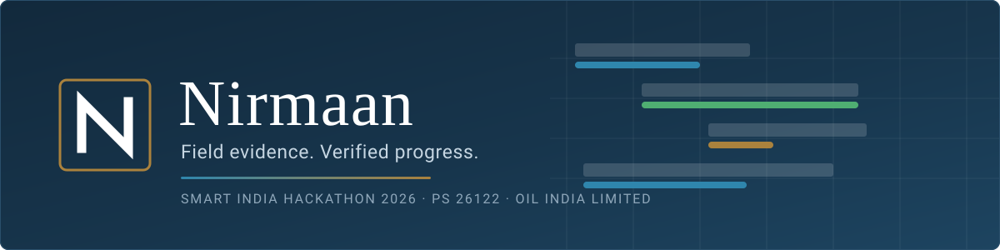
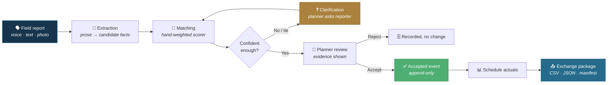
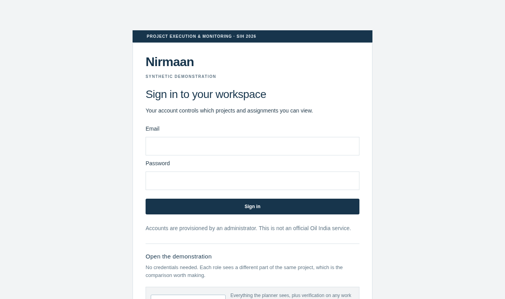
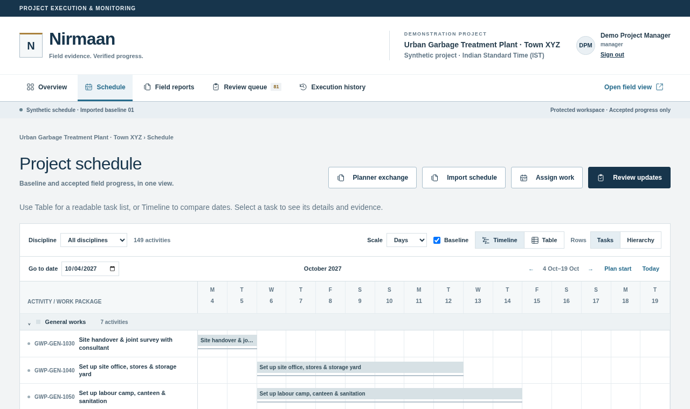
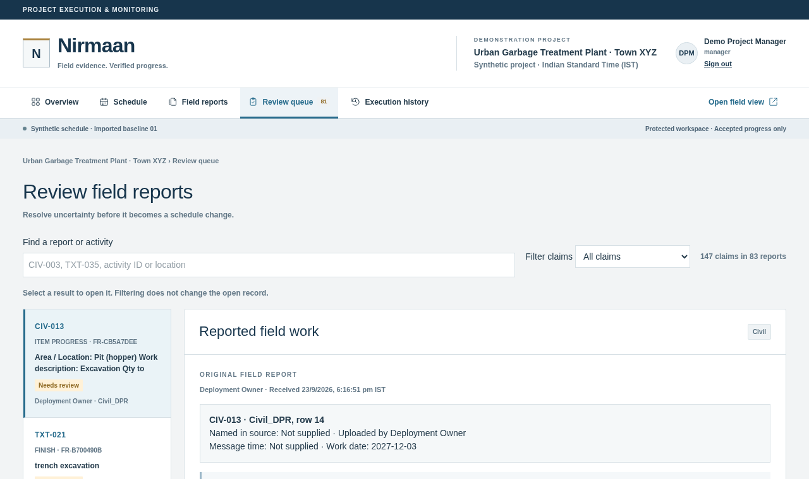
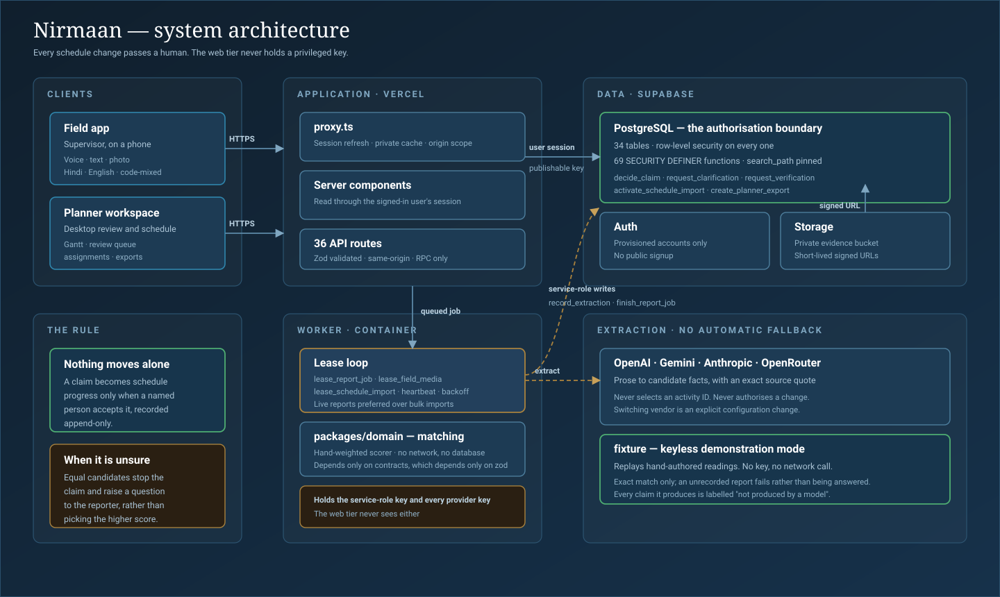

<div align="center">



# Nirmaan

### Turn what a supervisor says on site into a schedule update somebody signed for.

**Smart India Hackathon 2026 · Problem Statement 26122 · Oil India Limited**

<br>

[](https://intelligrid-sih122.vercel.app/login)
[](https://youtu.be/mEQVCm0IRXY)
[](docs/demo-runbook.md)

<br>

[](https://github.com/ShivenduShivu/SIH122/actions/workflows/checks.yml)
[](#-verification)
[](#-security-model)
[](#-verification)

[](https://nextjs.org)
[](https://react.dev)
[](https://www.typescriptlang.org)
[](https://supabase.com)
[](https://nodejs.org)
[](https://tailwindcss.com)

<br>

[**The problem**](#-the-problem) · [**What makes it different**](#-what-makes-it-different) · [**How it works**](#-how-it-works) · [**Try it**](#-try-it-no-signup) · [**Features**](#-feature-map) · [**Architecture**](#-architecture) · [**Security**](#-security-model) · [**Run it**](#-run-it-locally) · [**Limits**](#-honest-limits)

</div>

---

## 🧩 The problem

On an EPC site, work happens in sentences.

> _"Spool erection on the 24-inch line finished today, two joints still pending NDT."_

That sentence has to become a dated row in a schedule a contractor eventually gets paid against. Today a planner retypes it, guesses what it matched, and the schedule drifts from the site a little more every week.

Automating the typing is the easy part.

> ### **The hard part is that a wrong guess is worse than no guess.**
>
> It writes a false actual date into a commercial record, and nobody notices until a claim is disputed.

So the design question is not _"how do we extract more?"_ It is _"what do we do when we are not sure?"_

---

## ⭐ What makes it different

Ten things a generic "AI reads your reports" tool does not do.

| #      |                                            |                                                                                                                                                                                       |
| :----- | :----------------------------------------- | :------------------------------------------------------------------------------------------------------------------------------------------------------------------------------------ |
| **1**  | **Refuses to guess**                       | Two activities fitting equally well stops the claim and raises a question. In the live demo, two 24-inch lines tie at **0.350** — the product does not break the tie itself.          |
| **2**  | **Evidence, never a bare score**           | Every candidate shows the location, stage, discipline and exact quote behind it, and the page states outright that scores rank matches and are not probabilities.                     |
| **3**  | **Authorisation in Postgres, not the UI**  | **34 of 34** tables under row-level security; **69 of 69** `SECURITY DEFINER` functions with `search_path` pinned. A bug in the interface cannot widen access.                        |
| **4**  | **Append-only history**                    | Every acceptance records who, when, and against which schedule revision and policy version. A trigger blocks updates and deletes, including for the operator.                         |
| **5**  | **The model extracts; it never decides**   | Ranking is a hand-weighted scorer with no network access, and acceptance is a human action. No model ever picks an activity ID.                                                       |
| **6**  | **Runs with no model at all**              | `EXTRACTION_PROVIDER=fixture` replays recorded readings with no key and no network call. Unrecorded reports fail rather than being answered, and every claim is labelled as scripted. |
| **7**  | **Reads planner workbooks unmodified**     | Row values and formula caches are preserved, never recalculated. Imports preview as an explicit revision before anything is applied.                                                  |
| **8**  | **The reporter speaks their own language** | Voice, text or photo — Hindi, English or code-mixed. No forms, no activity codes to memorise.                                                                                         |
| **9**  | **Models ambiguity, not averages**         | Date basis, quantity coverage, percent basis and inspection relation are each recorded, so _"98% density"_ stays a test result instead of becoming 98% progress.                      |
| **10** | **Verification that cannot be worn down**  | A supervisor confirms work they did not report, inside their own scope. After a denial, only a project manager can order a fresh check.                                               |

---

## ⚙️ How it works



The schedule only ever moves at the **Accept** step, and that step always has a name attached.

---

## 🚀 Try it, no signup

### **[intelligrid-sih122.vercel.app](https://intelligrid-sih122.vercel.app/login)**

Four buttons. No credentials to type, no account to create.

<div align="center">

</div>

| Open as                | Sees                             | Can do                                                                                                                       | Cannot do                             |
| ---------------------- | -------------------------------- | ---------------------------------------------------------------------------------------------------------------------------- | ------------------------------------- |
| 👔 **Project manager** | Whole project                    | Everything a planner can, plus verification on **any** work front; the only role that can order a fresh check after a denial | —                                     |
| 📋 **Planner**         | Whole project                    | Schedule, review queue, assignments, exports; accepts or rejects every reported event                                        | Override a supervisor denial          |
| 🔍 **Supervisor**      | Their contractor and work fronts | Independently confirm work they did not report                                                                               | Assign work; act outside their scope  |
| 🦺 **Field reporter**  | Only their assigned work         | Submit progress by voice, text or photo                                                                                      | See other reporters' work or evidence |

Opening each in turn is the fastest way to see the point: **one project, four genuinely different views**, enforced in Postgres rather than in the interface.

> ⚠️ Synthetic project data only. Those sign-ins are published deliberately — treat anything recorded there as public, and expect the workspace to be reset.

---

## 🗂️ Feature map

<table>
<tr><td width="25%" valign="top">

**🎙️ Field capture**

</td><td valign="top">

Voice recording with on-device WAV encoding · Typed reports · Photo evidence with private storage · Recoverable drafts · Code-mixed Hindi/English · Per-reporter task list

</td></tr>
<tr><td valign="top">

**🧠 Understanding**

</td><td valign="top">

11 event kinds — `START` `FINISH` `ITEM_PROGRESS` `PERCENT_PROGRESS` `MILESTONE` `INSPECTION` `BLOCKED` `RESUMED` `CORRECTION` `PLANNED_INTENT` `UNKNOWN` · Observation contract v2 with date basis, quantity coverage, component scope, percent basis and inspection relation · Exact-quote evidence for every claim · Vocabulary normalisation over the supplied corpus

</td></tr>
<tr><td valign="top">

**👤 Review & control**

</td><td valign="top">

Ranked candidates with match reasons · Change preview before acceptance · Clarification questions back to the reporter · Independent supervisor attestation · Re-match and reprocess · Report withdrawal and scoped correction · Optimistic concurrency on every decision

</td></tr>
<tr><td valign="top">

**📅 Schedule & exchange**

</td><td valign="top">

Gantt timeline, table and hierarchy views · Baseline versus accepted actuals · Discipline filter · Workbook and CSV import with preview and activation · Immutable revisions · Export package of `activities.csv`, `evidence.csv`, `exceptions.csv`, `snapshot.json` and a hash `manifest.json`

</td></tr>
<tr><td valign="top">

**🔐 Platform**

</td><td valign="top">

Row-level security on all 34 tables · Private evidence storage with short-lived signed URLs · Append-only audit · Leased worker jobs with heartbeat and backoff · Four AI vendors plus a keyless fixture mode · Container builds for web and worker

</td></tr>
</table>

<div align="center">


</div>

<div align="center"><i>Schedule with baseline versus accepted progress · Review queue with the original report preserved</i></div>

---

## 📊 The data was supplied, not invented

Oil India answered our SIH 26122 questions with three workbooks — an L4–L6 construction schedule, an L3 schedule and a field-input corpus. They describe a conceptual garbage-treatment plant, not a live project.

We parse them **unmodified**, preserving source row values and formula caches. The running demonstration carries:

<div align="center">

|         149          |  147   |       83       |      9      |
| :------------------: | :----: | :------------: | :---------: |
| reporting activities | claims | source reports | disciplines |

</div>

---

## 🏗️ Architecture

<div align="center">



</div>

```
apps/web            Next.js planner and field interfaces · 36 API routes
apps/worker         leased extraction and matching jobs · holds the private keys
packages/domain     pure matching rules · no React, no database, no model calls
packages/contracts  runtime-validated shapes shared by both ends
packages/adapters   providers, transcription, workbook import
supabase/           15 migrations · 34 tables · 69 SECURITY DEFINER functions
```

**Boundaries are enforced by the dependency graph, not by convention.** `packages/domain` declares exactly one dependency — `@nirmaan/contracts`, which in turn declares only `zod`. It therefore _cannot_ import React, a database client or a model SDK; the import would not resolve and the build would fail.

The worker is the only component that ever holds a provider key or the service-role key. The standalone web launcher strips every provider prefix and the service-role key from its child process, even when the operator's own shell has them set.

---

## 🔐 Security model

| Control                                      | Status                                                         |
| -------------------------------------------- | -------------------------------------------------------------- |
| Row-level security                           | **34 of 34** tables                                            |
| `SECURITY DEFINER` with pinned `search_path` | **69 of 69** functions                                         |
| Service-role key in the web app              | **Never** — worker only                                        |
| Public signup                                | **Disabled** — accounts are provisioned                        |
| Cross-origin mutations                       | Rejected on every route                                        |
| Evidence storage                             | Private bucket, short-lived signed URLs, owner or planner only |
| History tables                               | Append-only, enforced by trigger                               |
| Dependency advisories                        | **0** high or critical                                         |

Three tables are deliberately left with RLS on and **no policy at all** — they are reachable only through audited `SECURITY DEFINER` routines, never by direct query.

---

## 💻 Run it locally

Node 24 LTS, npm and Docker. The version is pinned in `.nvmrc` and `.node-version`, and `engine-strict` makes `npm ci` fail on anything else.

```sh
npm ci
# then follow docs/local-development.md to start Supabase and seed
npm run dev          # http://localhost:3000/login
npm run worker:start # second terminal, after choosing a provider
```

Sign in with the generated local credentials in ignored `.cache/demo-accounts.json`.

📖 Full setup for both bash and PowerShell: **[docs/local-development.md](docs/local-development.md)**

---

## ✅ Verification

```sh
npm run check          # strict types, 171 unit tests, fixtures, worker boundary
npm run test:database  # real-user RLS, assignment and private-storage checks
npm run test:browser   # Playwright, including 320 px and 390 px layouts
npm run deploy:check   # credential separation and origin shape
```

CI runs **three jobs on every push**:

| Job            | What it proves                                                                                                                       |
| -------------- | ------------------------------------------------------------------------------------------------------------------------------------ |
| **foundation** | Strict types, 171 unit tests, production build                                                                                       |
| **deployment** | `npm audit`, credential preflight, container build with header and login checks                                                      |
| **database**   | Boots a real Supabase and runs the full authorisation, reconciliation, clarification, import, observation, exchange and media suites |

<details>
<summary><b>Every command, including the ones that cost API tokens</b></summary>

```sh
npm run check        # strict types, domain/contracts, fixtures, worker boundary
npm run build        # production Next.js build
npm run test:seed    # verify repeated seed has no database changes
npm run test:database # real-user RLS, assignment and Storage checks; local seed required
npm run test:reconciliation-db # acceptance/worker invariants; local synthetic test data
npm run test:clarification-db # question, verification, correction and withdrawal checks
npm run test:import-db # file/preview/activation and authority checks
npm run test:import-paging # 260 leaves and 241 assignment-history records
npm run test:observations-db # field-import outcomes and lineage
npm run test:exchange-db # immutable export and revision checks; stop worker first
npm run test:media-db # isolated media/reservation/retry checks; stop worker first
npm run test:queue-priority-db # live reports ahead of bulk imports
npm run test:containers # build and run the production web/worker images; Docker required
npm run deploy:check # production origin, credential and worker configuration shape

npm run seed:demo    # submit the recorded demonstration reports; needs the local seed
npm run seed:clarification # separate room demo; ignored local credentials
npm run seed:gwp     # separate synthetic plant; preserves existing data
npm run provision:demo -- --confirm # published demonstration accounts on a hosted project

npm run test:browser # running app on :3000; Playwright
npm run test:browser:live # real OpenAI + browser approval; consumes API tokens
npm run test:browser:clarification # real provider room flow; fresh uncompleted demo required
npm run test:browser:clarification-review # inspect saved room run and final screens
npm run test:browser:import # running app; uploads only if plant is still empty
npm run test:browser:exchange # GWP demo; creates ZIP and unactivated revision preview
npm run test:browser:media # running app, synthetic mic + real OpenAI; consumes API tokens
npm run evaluate:speech -- fixtures/speech/synthetic.json # synthetic smoke metrics only
```

Browser checks use Playwright and Chromium. Install once with `npx playwright install chromium`, or set `BROWSER_EXECUTABLE` to a local Chromium/Edge. `BASE_URL` overrides the local URL. Screenshots and results go to ignored `test-results/`.

</details>

---

## ⚠️ Honest limits

Stated here so nobody has to go looking.

| Limit                              | Detail                                                                                                                                                        |
| ---------------------------------- | ------------------------------------------------------------------------------------------------------------------------------------------------------------- |
| **No native Primavera writer**     | Import accepts four explicit workbook and CSV profiles, capped at 2,500 rows. Export is CSV and JSON with a manifest. No XER or PMXML round-trip yet.         |
| **Not an offline PWA**             | Drafts survive in local storage as text. A voice recording made with no network is not preserved.                                                             |
| **Matcher is not learned**         | A reviewed, hand-weighted scorer, never scored against an organiser answer key. Figures in `docs/` are row-level candidate coverage, not final-link accuracy. |
| **Provider quality is per-vendor** | OpenAI evaluation numbers do not transfer to Gemini, Claude or OpenRouter. New adapters have mocked transport tests only.                                     |
| **Deployment is CLI-driven**       | Hosted speech quality and physical Android/iPhone checks are still open.                                                                                      |

---

## 📚 Documentation

| Document                                                        | What is in it                                                                              |
| --------------------------------------------------------------- | ------------------------------------------------------------------------------------------ |
| [Demonstration runbook](docs/demo-runbook.md)                   | The rehearsed path, failure table, and limits to state aloud                               |
| [Local development](docs/local-development.md)                  | Setup, seeding, roles and checks — bash and PowerShell                                     |
| [Provider setup](docs/providers.md)                             | All four vendors plus the keyless fixture mode                                             |
| [Operations](docs/phase-07-operations.md)                       | Deployment order, health checks, recovery rehearsal                                        |
| [Technical architecture](planning/07-technical-architecture.md) | Version 1.1, [superseded by the 1.2 alignment](planning/09-architecture-alignment-v1.2.md) |
| [Implementation phases](docs/implementation-phases.md)          | Phase instructions, gates and commit conventions                                           |
| [Phase reports](docs/reports)                                   | Evidence behind each phase, including what was _not_ verified                              |

<details>
<summary><b>Contributing conventions</b></summary>

Only approved phases are staged and committed. Never commit `.env`, provider keys, backups, `node_modules`, raw browser output or scratch files — reviewed evidence belongs in a phase report. Package versions are pinned by `package-lock.json`. `.github/workflows/checks.yml` runs the foundation, dependency/container/preflight and fresh-database authorisation gates on every push.

The product is named **Nirmaan**; some earlier implementation records retain the former name, IntelliGrid.

</details>

---

<div align="center">

### Nirmaan

**Smart India Hackathon 2026 · Problem Statement 26122 · Oil India Limited**

BITS Pilani

<sub>Student prototype on synthetic data. Not an official Oil India service.</sub>

[](https://intelligrid-sih122.vercel.app/login)

</div>
