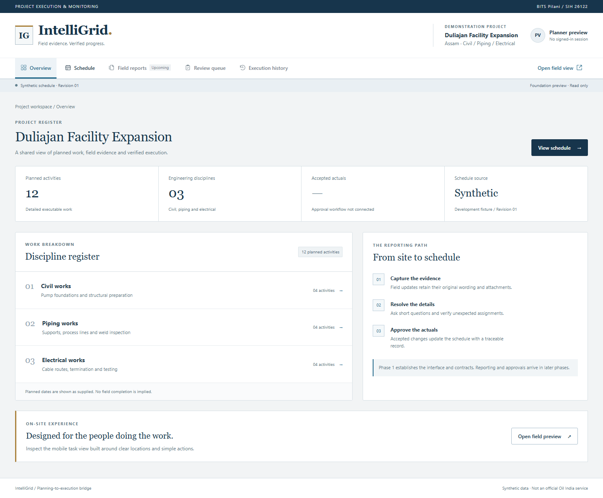
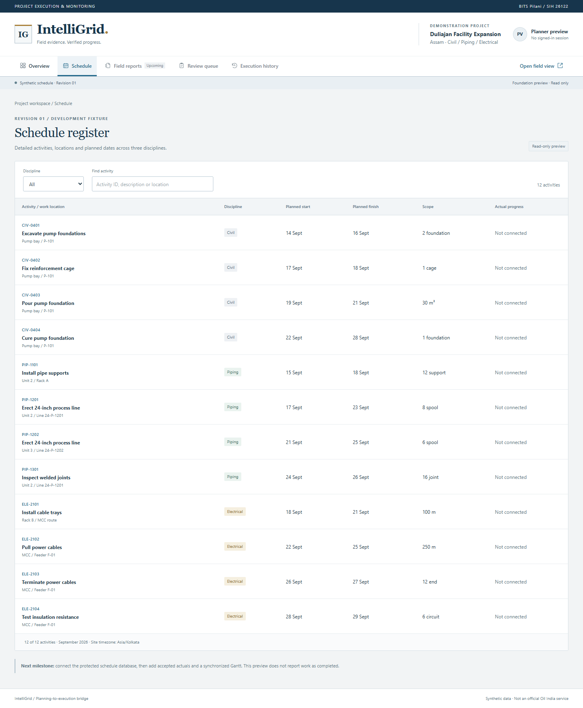
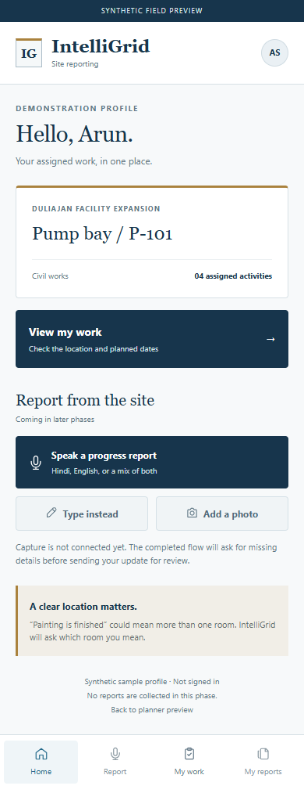
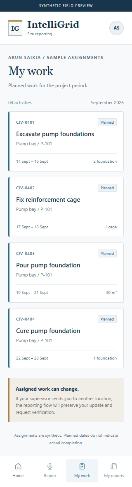

# Nirmaan - Phase 1 completion report

Date: 20 September 2026. Status: **approved with design-fidelity corrections and explicitly tracked follow-up work**.

The user accepted the Phase 1 foundation and allowed the remaining approved-design details to land in later phases. The review identified missing navigation icons and drift in the desktop overview, timeline and mobile flow. Outline icons, the four mobile navigation destinations and voice-first action hierarchy were restored before committing. `docs/design-fidelity.md` maps the remaining requirements to their phase gates; the scaffold is not a replacement design.

## Outcome

The repository now contains a runnable Next.js application, shared runtime contracts and pure domain helpers, a worker configuration boundary, development fixtures and repeatable checks. The name is Nirmaan, as selected by the team. The planner uses the approved institutional top navigation and restrained navy styling; the mobile shell emphasizes assigned work and locations.

The eight-phase plan is in `docs/implementation-phases.md`. Every phase ends with a report and user review. Approval triggers staging, a descriptive commit and a normal push to origin/main before the next phase begins.

## Implemented

- npm workspace structure: `apps/web`, `apps/worker`, `packages/contracts`, `packages/domain`.
- Node 24 requirement, pinned dependency lockfile, strict TypeScript, Prettier configuration and GitHub CI definition.
- Nirmaan branding module and icon; overview, filtered schedule register, field home and assigned-work screens.
- Twelve planned facility activities across three disciplines, two fixture projects, two contractor identifiers, seven sample members and three ambiguity scenarios.
- Zod validation for planned activities, date-only evidence, initial text drafts, claims, lifecycle states and versioned review commands.
- Domain helpers that preserve missing location, propose short clarification questions and flag assignment differences without overwriting the reported activity.
- Fixture validation, unit/contract tests, browser smoke checks and an honest health response (`databaseConnected: false`).
- Setup instructions, architectural decision record, secret/build/scratch exclusions and a detailed phased delivery plan.

## Verified results

| Check | Observed result |
| --- | --- |
| `npm run check` | Passed: root/web TypeScript, route type generation, 22 tests, fixture relationships and worker configuration check |
| `npm run build` | Passed: production Next.js 16.3.5 build; planner, schedule, field, work and health routes generated |
| `npm run test:browser` | Passed against the production server using installed Microsoft Edge through Playwright; no page errors |
| Browser interactions | Root redirect, planner navigation, discipline filtering, location search, empty-result recovery, field task navigation and health response |
| Layout | Desktop at 1440px; field and planner schedule at 390px and 320px; no document-level horizontal overflow in checked narrow views |
| Visual inspection | Reviewed rendered overview, schedule, field home and narrow field task screenshots |
| Formatting | Prettier check passed for authored application, contracts, fixtures and tests |
| Dependency installation audit | 0 vulnerabilities reported by npm at installation; this is not a production security assessment |
| Git | `main` initialized; origin configured; remote branch query returned no branches; Git index remains empty |

The first browser run found an ambiguous accessible label for the discipline select. It was fixed with explicitly associated labels, then the updated build and browser checks passed. The machine's default Node 22 caused an initial installation failure; all successful checks used the available Node 24.19.0 runtime. Global runtime configuration was not changed.

CI is defined but has not run on GitHub because this phase has not been pushed. Narrow browser viewport checks are not a real-device or offline PWA test.

## Deliberate phase boundaries

This is a public **synthetic preview**, with no authentication or real user sessions. It does not collect reports, call AI providers, write a database, approve progress, synchronize a Gantt or connect to Primavera. The field capture controls are disabled and marked as upcoming. The worker only checks configuration and exits. Fixture filtering is not evidence of RLS or contractor security.

Those capabilities remain in their planned phases: database/auth/RLS in Phase 2; persisted text-to-approval/Gantt flow in Phase 3; real question/verification records in Phase 4; speech/files/offline capture in Phase 5; delivery/history in Phase 6.

No known blocker remains inside the Phase 1 scope. Phase 2 needs a running local Supabase/Docker environment or an authorized development project. Docker is installed on this machine but its Linux daemon was not running when checked; no Supabase account or secrets were requested during Phase 1.

## Review locally

With the preview server running:

- Planner: http://localhost:3000/planner
- Schedule: http://localhost:3000/planner/schedule
- Field home: http://localhost:3000/field
- Assigned work: http://localhost:3000/field/work

For a fresh run, use Node 24, `npm ci`, then `npm run dev`. Production mode is `npm run build` followed by `npm start`. Browser checks need installed Chromium or `BROWSER_EXECUTABLE` pointing to Edge/Chromium. See the root README.

## Screenshots

## User review gate

User review accepted the phase with the design corrections described above. Proceed with the approved commit/push after the updated checks pass. The remaining overview, Gantt and mobile assignment details are mandatory deliverables in the mapped later phases.

After approval, inspect and stage the intended foundation files plus existing project planning/design artifacts (excluding ignored scratch/build files), then commit:

`chore: establish Nirmaan foundation and phase workflow`

Push that commit to `https://github.com/ShivenduShivu/SIH122.git` on `main`, without force. Inspect remote state again before pushing. If author identity or authentication is missing, request the specific missing setup rather than inventing it. Record the resulting commit hash in the next phase's report.

This report accompanies the Phase 1 commit. The resulting commit hash and push outcome will be recorded in the Phase 2 report to avoid a self-referential commit hash.
