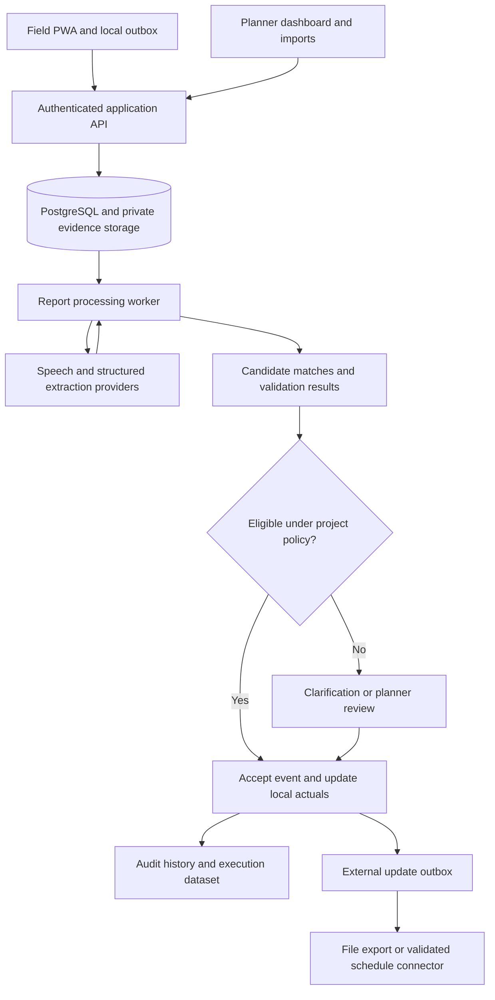

# SIH26122 — Architecture proposal and first build backlog

> Implementation authority: planning/07-technical-architecture.md version 1.1 supersedes conflicting details here, including clarification, supervisor verification, provisioning and Gantt synchronization.

Date: 20 September 2026. Team institution: BITS Pilani.

Status: concrete proposal for the architecture discussion. No application code, vendor accounts, paid services, or deployment have been created. This extends the research and requirements; it does not assert compatibility with OIL's unverified production environment.

## 1. Recommended shape

Use one TypeScript application for the planner dashboard, field PWA, and server API. Keep the business logic in distinct modules inside that application. Use PostgreSQL for structured records and private object storage for source files. A small worker from the same repository processes persisted report jobs. This is one product and shared codebase, with web and worker processes; it does not need independently deployed domain services.

Accepting an event and updating the local schedule projection should happen together in a database transaction. External delivery happens afterward, with its own status. If the destination is unavailable, the interface must not claim it was updated.

## 2. Technology recommendations

| Area | Proposed choice | Reason and limit |
| --- | --- | --- |
| Web app and server endpoints | Next.js, React, TypeScript | Shared types and one codebase for both interfaces. Keep the offline field shell usable without a fresh server render. |
| UI styling | Tailwind CSS with deliberately designed tables, forms, and drawers | Fast consistent implementation; visual decisions follow the supplied references and evidence workflow. |
| Structured records | PostgreSQL, provisionally through Supabase | Projects, activities, claims, reviews, and updates have strong relationships. Transactions and constraints support reliable acceptance. |
| Login and file storage | Supabase Auth and private Storage | Reduces account and upload plumbing during the week; project and contractor permissions still need explicit implementation. |
| Offline reports | Dexie over IndexedDB, plus service-worker caching | Store report drafts, attachment blobs, capture IDs, and upload status locally. Dexie itself does not synchronize the server. |
| Voice | Sarvam speech-to-text as the first candidate | Its documented code-mixed modes fit the proposed languages. Confirm tag/date accuracy on team recordings before committing. |
| Event extraction | Gemini structured-output API as the first candidate, behind a small provider interface | Produces schema-shaped output. The supported model ID must be selected and pinned after a short benchmark and checking account access. Schema compliance is not factual correctness. |
| Matching | Identifier and terminology search followed by bounded model-assisted comparison | Fits the initial 60–90 activity dataset. Preserve an exact/keyword baseline for evaluation. |
| Spreadsheet input/output | ExcelJS for a defined XLSX template and simple CSV handling | One documented template first. Treat cells as data; reject unsupported layouts with a useful message. |
| Schedule visualization | Table first; Frappe Gantt for the timeline if its behavior fits | Frappe Gantt is MIT-licensed. Its built-in progress/working-day calculations must not replace our source schedule rules. |
| Background processing | Small Node worker with persisted PostgreSQL jobs | Durable retry without adding another queue service at this scale. |
| Dashboard refresh | Bounded polling initially | Adequate for a small demo; push subscriptions can be added if they materially improve responsiveness. |

Capability references: [Next.js PWA guide](https://nextjs.org/docs/app/guides/progressive-web-apps), [Supabase row-level security](https://supabase.com/docs/guides/database/postgres/row-level-security), [Supabase storage access control](https://supabase.com/docs/guides/storage/security/access-control), [Dexie documentation](https://dexie.org/docs), [Sarvam speech API](https://docs.sarvam.ai/api/api-guides-tutorials/speech-to-text/overview), [Gemini structured outputs](https://ai.google.dev/gemini-api/docs/structured-output), [ExcelJS](https://github.com/exceljs/exceljs), [Frappe Gantt](https://github.com/frappe/gantt).

These choices are engineering recommendations for this prototype, not a claim that they are mandated by OIL or universally standard. Pin supported package versions at implementation time.

## 3. Why this fits the problem

Primavera integration depends on stable activity identities, dates, status rules, supported exchange formats, and access permissions. Using an Oracle database ourselves would not automatically make integration work.

PostgreSQL provides a natural place to preserve relationships and enforce one accepted effect per event. Supabase is a speed-of-delivery choice for the prototype. A later OIL deployment might require different identity, storage, hosting, and model providers; moving those is work, so keep their interfaces separate from event and matching rules.

A Python service is unnecessary for API-based speech and extraction. Add one only if a demonstrated parser or model dependency requires it. A separate vector database is also unnecessary. If semantic retrieval improves measured recall later, PostgreSQL can support vector search via pgvector; that is optional and still needs scoped access controls. [Supabase vector support](https://supabase.com/docs/guides/ai/vector-columns).

The distinctive engineering belongs in field-to-activity relationships, validation, reviewer decisions, and evaluation. A multi-agent framework or generic chat layer does not supply those automatically.

## 4. Record ownership and permission boundaries

| Records | Who creates or changes them |
| --- | --- |
| Projects, schedule revisions, WBS and planned activities | Authorized planner through import or controlled edits |
| Field assignments and completion rules | Planner or authorized supervisor |
| Raw reports and attachments | Authorized project reporter/importer; source retained after submission |
| Extracted claims and candidate matches | Processing worker; marked as proposals |
| Review decisions | Authorized reviewer, with a recorded reason when correcting or rejecting |
| Accepted events, actuals, audit and update outbox | Controlled acceptance operation; no unrestricted browser writes |

Every project-scoped record carries project identity. Match candidates only inside the authorized project, then use location, discipline, tags, and task selection to narrow/rank. Never trust a client-supplied project ID or a model-generated activity ID without checking it.

Use database row policies and server authorization together. Private attachments need their own access policies. Administrative keys stay on the server. A worker using privileged credentials must explicitly restrict every job to its recorded project and allowed operation.

One acceptance transaction checks authority, expected activity revision, required facts, and existing event effects. It records the decision, applies allowed actuals, and inserts the audit/outbox records. An already-accepted event returns its existing result. A stale review returns a conflict for fresh inspection.

The audit is append-only through application permissions. Do not claim that this makes it impossible for an infrastructure administrator to alter the database.

## 5. Processing a report

1. Save it locally with a unique capture ID. The server acknowledges only after persisting the report metadata; attachment receipt is tracked separately.
2. Queue a processing job once its required input is available.
3. Read the text or spreadsheet, or transcribe the audio. Retain the original source and a line/cell/segment locator where available.
4. Extract claims: action, asset, location, event kind, event date/time and precision, quantity/unit, and missing information.
5. Retrieve plausible activities, keeping late and early work eligible. Explicit tag mismatches must not be concealed by language similarity.
6. Compare candidates and classify full-activity versus partial-item scope. Preserve reasons and alternatives.
7. Run deterministic validation and the agreed project policy. Send uncertain cases to clarification/review.
8. Apply eligible events through the acceptance operation. Dashboard reads accepted actuals separately from provisional reports.

The model receives data and a bounded extraction/matching task, not schedule-write credentials. Source documents cannot issue operational instructions. Invalid, incomplete, or timed-out model output becomes a visible pending/failed processing state.

An assigned task is useful context, but the demo must include unassigned text and spreadsheet reports. Otherwise it never proves the fuzzy-linking requirement.

## 6. Offline and processing reliability

The service worker caches the field shell; IndexedDB stores project-authorized task snapshots and pending captures per signed-in user. Avoid caching authenticated server responses indiscriminately. Keep last-sync time visible. Recheck identity and permission before uploading or applying an offline report.

Support foreground retry on app open/reconnect and a visible retry action. Do not promise that every browser will upload while closed. Recording can work offline while transcription waits for connectivity. Storage failures must be visible before presenting a report as saved.

Worker jobs have a status, attempt count, retry time, and expiring processing lease. A restart can reclaim unfinished jobs. Repeat execution must not duplicate accepted events. Cap upload sizes, spreadsheet rows, audio duration, and retries to a declared demo envelope.

The deployment needs an actual worker process or a durable-job platform. Do not start unawaited processing inside a short-lived web request and assume it will finish. Initial hosting shape is a web process plus worker connected to managed data/storage; choose the host after confirming existing accounts and budget. No paid provisioning is required to discuss this design.

## 7. Scope of the first schedule adapter

Begin with an explicit CSV/XLSX exchange template containing project and activity IDs, WBS references, names, discipline/location codes, planned dates, actual dates where present, and status. Document optional fields and reject identity collisions.

Preserve raw imported rows and an import revision. Do not call an arbitrary spreadsheet “P6 compatible.” A P6-specific export needs the target template/version and an actual import/read-back test. The first demo can truthfully show an exchange export and a simulated delivery destination.

Keep baseline dates, current plan dates, and actual dates separate. Display unknown dates as unknown. External update records carry destination IDs, changed fields, prior values/revision when available, and delivery acknowledgement. File export, destination acceptance, and schedule recalculation are separate facts.

## 8. First build backlog

This is the order for implementation after the architecture discussion. Each item has a visible exit condition.

| Order | Work item | Done when |
| --- | --- | --- |
| 1 | Create the canonical mini-project and event rules | Twelve representative activities include similar assets, one partial-scope relationship, and explicit completion rules |
| 2 | Define the source/claim/event contracts and roles | A report can be mapped through extraction, review, acceptance, and export without losing its original evidence |
| 3 | Add schedule import and role-scoped access | Planner sees the imported schedule; reporter sees authorized work; cross-project access is rejected |
| 4 | Add text capture and durable processing | Reloading the page does not lose a submitted report; processing failure is visible and retryable |
| 5 | Add candidate matching and review | A clear report links; an ambiguous one shows candidates; unmatched work remains in the queue |
| 6 | Add atomic acceptance and audit | Correct actual changes once, source is visible, stale approval is rejected, and retry has one effect |
| 7 | Add export/outbox and schedule presentation | User can distinguish local acceptance from external delivery; baseline remains unchanged |
| 8 | Extend to spreadsheet, voice, and offline capture | The same event pipeline handles all three inputs; offline reload/reconnect works on a real phone |
| 9 | Expand synthetic benchmark and history views | Frozen held-out cases run; history queries link back to evidence and label synthetic observations |

Day-two milestone: import → unassigned text report → activity proposal → review/acceptance → actual date → audit. Voice, advanced Gantt customization, and charts follow this working path.

## 9. Short model and UI checks before committing

Use a small development set to compare candidate extraction outputs with known facts. Measure tag/date/negation accuracy, invalid outputs, latency, and cost per report. Include similar suffixes, partial completion, future work, and unknown times. Keep the larger held-out set untouched.

Record English and Hindi/Hinglish examples using real team speakers. Confirm how spoken asset identifiers survive transcription. If the selected provider performs poorly, switch the adapter rather than changing the accepted-event rules to accommodate its mistakes.

Check Frappe Gantt against one representative schedule for row selection, date display, and baseline/actual presentation. If baseline overlay needs substantial customization, use explicit date columns and a simpler timeline for the prototype. Reliable reconciliation takes priority over reproducing every reference screenshot feature.

## 10. Decisions affected by OIL's reply

- Actual Primavera edition, sample format, and interface access may change the schedule adapter.
- Approval and completion rules may change acceptance policy.
- Hosting and AI-processing restrictions may change providers and deployment.
- Field languages and connectivity may change recording and offline priorities.

These replies should not require rewriting the separation between raw reports, proposed facts, accepted events, and schedule delivery. That separation is the core architectural commitment being proposed.
