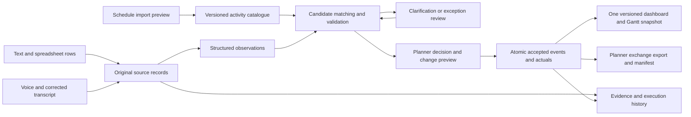

# Nirmaan — architecture alignment v1.2

21 September 2026 · BITS Pilani · SIH 26122

**Status: approved design following Phase 4A review on 21 September 2026. This document does not describe newly implemented features.** It supersedes conflicting scope, fixture, provider and remaining-phase decisions in architecture v1.1. Existing integrity and authorization guarantees remain required. See [source reading notes](08-oil-india-reference-review.md), [code-backed gap report](../docs/reports/phase-04a.md) and [implementation gates](../docs/implementation-phases.md).

## 1. Product outcome and boundaries

Nirmaan turns supervisor reports and discipline spreadsheets into traceable activity-level updates for the planning engineer. It should save reconciliation effort without hiding missing information. The primary demonstration will use the supplied garbage-treatment-plant schedule; existing Duliajan and room fixtures remain regression cases. All are labelled synthetic. The supplied project is a test case, not an assertion that OIL operates that plant.

The essential demonstration is: import a schedule → capture varied reports → split and interpret the facts → propose activity links → ask short questions where needed → planner accepts valid changes → Gantt and accepted records converge → produce a planner exchange file. Unresolved items remain searchable. No live OIL connection is required.

The FAQ confirms P6, supervisor reporting, planner accountability, date-level actuals, optional offline capture, English/Hindi demonstration and a file-based integration route. Hierarchy roll-ups, critical-path scheduling and risk forecasting remain P6/downstream responsibilities. Capturing a reported hindrance is in scope; predicting its project delay is not.

Additions beyond the explicit minimum must improve accuracy, ease of reporting or planner throughput. They must not weaken review controls or consume the core delivery window.

## 2. Keep the existing stack and successful path

Keep Next.js, the separate TypeScript worker, PostgreSQL/Supabase authentication and private storage, versioned jobs, strict extraction validation, atomic acceptance, immutable evidence/event history and the versioned schedule snapshot. No database migration to another platform is justified by these documents. Deployment region and network latency still need measurement; the local observed timings are not a hosted-service guarantee.

Keep the existing **OpenAI extraction adapter**, as requested by the user. Gemini in v1.1 is obsolete. Keep provider/model/prompt metadata and the replaceable adapter boundary. Audio transcription is a separate adapter: begin the implementation probe with the already configured OpenAI provider, verify available transcription configuration then, and test English/Hindi critical facts before selecting the demo model. Sarvam is a possible fallback if measured results justify another integration, not a required dependency. No speech API or language performance is claimed to work today.

Do not add a vector database, autonomous planning agent, message broker or microservice fleet for this fixture. Begin with explicit aliases, hierarchy-aware retrieval and deterministic validation. Use measured retrieval failures to justify later search changes. The existing application retains planner-only mutation of accepted schedule facts.

## 3. Schedule import and identity

Add a two-step import: **preview, then activate**. Parsing creates a draft revision and a row-by-row manifest; it does not update the active schedule. Activation requires planner authority, the expected current revision, a confirmed mapping and an idempotent command. A retry must not create another revision. Missing required mappings or broken relationships prevent activation, with visible row errors.

Phase 5A activation is restricted to initial imports into the new synthetic project, with both source schedules consolidated before activation. An identical retry is allowed; replacing a revision already used by reports or accepted events remains disabled until the Phase 6A revision-conflict path is tested. Do not temporarily bypass that protection to demonstrate import.

Support the supplied workbook profiles first, plus a documented canonical CSV. Do not advertise arbitrary Excel/MS Project/XER import. Preserve source file hash, sheet, row, raw IDs, original units, formulas/cached values where relevant, and parser version. Never execute macros, external workbook links or spreadsheet formulas. If required dates have no usable cached value, request a saved-values export instead of inventing results. Bound file size, decompressed size, row count and processing time; define and enforce these limits with the importer.

Separate three identities:

- **Internal activity ID:** stable database identifier within a project.
- **Source Activity ID:** the external linking key, unique within the project/source namespace. Do not merge unrelated imports solely because IDs happen to match.
- **Hierarchy node:** a summary, package or area used to locate work. Its name is context, not an executable activity ID.

Represent imported nodes with source ID/WBS, parent, source level, name, node kind (`summary`, `task`, `milestone`, `external_dependency`), `reportable`, discipline code, calendar and source provenance. Keep explicit parent relationships rather than guessing depth from L5/L6 labels. In this workbook 149 L6 leaves are reportable; 19 L4 and 40 L5 summaries and seven EXT dependencies are not ordinary field-update targets. The 11 contractor L3 nodes join the full project's 84 L3 activities by Activity ID; shared nodes must not be duplicated when both files are loaded. WBS strings are preserved separately because the two files use different representations.

Extend the discipline catalogue to GEN, HSE, QAQC, CIV, STR, MEC, PIP, ELE and INS, retaining source code and display label. Keep EXT as an external node category. Migrate existing Civil/Piping/Electrical values explicitly, including membership scopes, filters, colours, seeds and tests. Unknown future codes appear in import review; they are never silently coerced to Civil.

Planned quantity and unit become nullable together where the source has no quantity. Milestones have a zero duration and a milestone type; do not fabricate a target quantity of one. LS means lump sum and does not imply that six earth pits equal six complete activities. Retain dependencies and working-calendar metadata without implementing a CPM engine. A report can describe work outside baseline dates; that is not, by itself, invalid evidence.

Catalogue reads must be complete and paged with stable identity/order. The current 200-row worker limit is not evidence that 149 reportable leaves will fail, but importing all 215 rows indiscriminately would exceed it. Filter candidates to reportable leaves and remove completeness limits from catalogue/assignment-history reads through proper paging. Add a >200-leaf synthetic case separately. Fetch the full hierarchy for planner views without exposing unauthorized leaves to field users.

## 4. Source records and observation contract

All capture routes produce the same versioned source envelope. Add typed support for text, spreadsheet rows and voice transcripts. Preserve the original file/record even if a row is invalid or yields no executable event. A batch's counts reconcile: every selected non-header row is imported, rejected with a reason, or explicitly excluded by the user. Multi-event extraction must not truncate at the current 20-claim cap; bounded segmentation or a visible manual-review outcome is required.

| Data | Meaning and rule |
|---|---|
| `receivedAt` | Server receipt time; never substituted for the work date |
| `sourceMessageAt` | Timestamp in an imported message, nullable, with its supplied timezone/assumption |
| `reportingWorkDate` | Work-day context supplied by a reporter or spreadsheet; not proof every described event happened that day |
| `eventDate` | Date the event actually occurred, nullable |
| `dateBasis` | Explicit in text, source work-date column, inferred from relative wording, confirmed by a person, corrected by planner, or missing |
| `dateEvidence` | Source span/cell and, for an inferred date, the timestamp and rule used |
| `submittedBy` | Authenticated user who uploads/reports |
| `reportedByLabel` | Person named in imported evidence; not automatically an authenticated account |
| `sourceRecordId` | Original TXT/CIV/etc. identifier plus file/sheet/row coordinates |
| `scope` | Whole activity, component/item or unknown; keep area and item identifiers |
| `progress` | Reported percentage or quantity with unit, basis, scope and as-of date |
| `qualifiers` | Incomplete scope, separate inspection, uncertainty, interruption or other statement with its own evidence |

Resolve “today” against an explicitly documented message/work-day anchor and show it as inferred unless confirmed. “Will start tomorrow” remains planned intent, not an actual START. TXT045/046 remain dateless until answered. Use source scenario dates for the 2027–2028 demo; keep actual system receipt times truthful and show an explicit scenario/as-of date where needed.

Spreadsheet parsers retain typed cells and source excerpts. They should not flatten every row into an untraceable invented sentence. Header/column interpretation is deterministic for supported profiles; the model interprets narrative remarks where useful. Civil_DPR's daily and cumulative fields remain separate observations of the same work, not two additive progress events.

A record can be reviewed as useful evidence while remaining ineligible to update schedule actuals. For example, “60% complete” with no known start date is stored and shown as **reported progress — start date unresolved**. Do not display it as Not Started, invent a start date, or export it as a fully resolved schedule patch. The planner can resolve its missing date through evidence or clarification. The accepted schedule projection retains its existing date consistency constraints for normal tasks.

## 5. Matching and short clarification

Retrieve candidates using project/revision, reportable status, hierarchy names, area aliases, discipline, stage, asset/item tags and description. Assignment or selected-task context is a hint, not evidence that the work happened. Keep explicit mismatches visible. Add the supplied vocabulary as a versioned, reviewed dictionary: receiving hall ↔ tipping hall B; PCC ↔ blinding/lean concrete; rebar ↔ steel fixing. Do not turn the existing global `inspection → ndt` alias into a universal rule.

Repeated activity names require their ancestor path: `Process Buildings / Receiving Hall B / Foundations / Excavation`. Show the top candidates with why they match and what remains uncertain. A heuristic score is labelled a **match score**, not a probability of correctness. Do not enable high-confidence auto-acceptance on a score alone; it stays off for this demonstration unless later evaluation explicitly supports a narrow policy.

Ask one simple question that resolves the actual uncertainty: “Which hall: receiving hall or processing building?”, “Was this 350 cubic metres today, or 350 in total?”, or “What date did the work finish?” Ask only unresolved questions, retain the original report, and stop after the existing two automatic rounds before human review. Candidate choices are authorized; unrestricted text may be captured without disclosing another contractor's catalogue. Multiple activities keep separate claim lineages so answering one cannot change its siblings.

An unplanned classification is not a reason to lose the work. In Phase 5B, a planner can request a versioned rematch to an existing reporting leaf, with explanation and unchanged source evidence; validation and acceptance still apply. If the work needs a new planned activity, retain it in the register until a planner-approved schedule revision supplies that ID through Phase 6A. Then rematch explicitly. A field report must never create or modify the baseline by itself.

Supervisor reporting is already partly supported: current SQL permits scoped supervisors without an individual worker assignment. Preserve it and test it with the real corpus instead of rebuilding roles. The missing policy decision is the treatment of historical assignment dates: current helpers use the latest version without testing its effective dates. Define current access separately from who was authorized to perform/report work at the event date. Revoked membership never grants current access. Missing event dates cannot establish historical authority.

For the demo, a supervisor may report within their contractor/discipline/work-area authority and the planner still approves. Independent verification remains necessary for disputed work or out-of-scope allocation exceptions; do not require a second supervisor for every ordinary supervisor report. A bulk importer cannot impersonate everyone named in a DPR: uploader authority, claimed author and source provenance remain distinct.

## 6. Progress, duplication, completion and correction

Introduce a progress observation ledger: each quantity/percentage carries scope, basis, as-of date, source and review outcome. Derive the accepted current value from the reviewed ledger; keep version checks and before/after values. This is the record needed to reconcile evidence, not another analytics system.

Rules for the first implementation:

1. Percent is a distinct field in [0,100], with its declared basis or `unspecified`. Do not store 60% as 60 m3. A density test result of 98% is not activity progress. Do not convert physical percent into P6 duration percent.
2. Normalize only equivalent units (cum/m3, sqm/m2, RM/m) with the original value retained. Mixed units or component scopes require review. Truck counts have no default volume conversion.
3. Cumulative quantities replace the accepted total at their as-of point; they are not added. Daily deltas are additive only when their scope/time coverage is sufficiently known and has not already contributed. Reconcile daily and cumulative readings for the same day before applying either.
4. Ranged items such as S001–S040 and S001–S110 overlap. Keep normalized item coverage where explicit. Do not infer identity for unnumbered items. Overlap or unclear coverage becomes a reconciliation case, not a silent sum.
5. Exact upload retry has one effect. Repeated evidence in a message and DPR is linked as corroboration or duplicate after review; do not delete either source. Similar wording alone is insufficient to merge two legitimate events.
6. A late lower cumulative reading may be historical evidence rather than a new current total. Sort by event/as-of date with deterministic tie handling. Equal totals can corroborate; decreasing same-scope totals or contradictory percentages require correction review. Do not solve all cases by taking the maximum.
7. A verified quantity correction supersedes its accepted contribution with a reason and recalculates affected totals atomically. Wrong-activity corrections require a controlled reversal and new acceptance with both scopes checked; do not expose a generic edit-total endpoint. If that operation is not ready, keep the case visibly unresolved and disable its correction control.
8. A normal task FINISH requires resolved full scope and valid start/finish dates. A reported 100% or target quantity alone is not an automatic FINISH. A pending *separate* inspection does not block completed installation; an inspection included in the matched activity scope does. Mixed units in a finish report can be supporting evidence, not an automatic rejection merely because the plan uses another unit.
9. A milestone needs a reviewed occurrence date and type-specific projection; it does not require a fictional earlier start or quantity. Store the occurrence explicitly and let the exchange profile decide its representation. Do not apply normal-task duration assumptions.

## 7. Acceptance, Gantt and exchange consistency

Extend the existing transaction rather than introduce another update path. Validate membership, exact scope, current report/claim/revision/policy/actuals versions, duplicate/overlap decisions and verification state. In one transaction write the review decision, accepted event or correction, ledger projection, audit record, schedule version and export outbox entry. **Approved progress changes must enter the outbox too**; today ITEM_PROGRESS is marked `not_required` and omitted.

Separate the observation's review status, accepted schedule status and external delivery status. An unresolved observation cannot change the Gantt. Submitted, reviewed, accepted, exported and externally verified are different states. Retry commands return the same result; stale previews return a conflict and require a new preview.

Keep the coherent schedule snapshot and immediate refresh after approval, with five-second visible-tab polling as the fallback. Expand snapshot fields for hierarchy, node type, progress basis and accepted progress. Recompute displayed counts from reportable leaves only, never all 215 imported rows. Parent groups show context and leaf counts; optional observed min/max child dates are explicitly display summaries, not recalculated P6 schedules or official weighted percentages.

Extend the approved UI rather than replace it: top navigation and icons, serif headings, navy controls, thin borders, baseline toggle, Timeline/Table switch, source drawer and the four mobile tabs. Add nested package/area collapse, date-range navigation or day/week zoom, and clear milestone symbols. Show source units, original/normalized values, missing-date badges and acceptance status. Keep outstanding observations visible alongside accepted facts without painting them as approved actual bars.

Before an approval show a compact **change preview**: the exact activity path and ID; old and proposed dates/progress; evidence; unresolved checks; and affected export fields. This is an addition to the review panel, not a new primary tab.

Export the active accepted snapshot as a documented planner exchange CSV plus evidence/exception data and a JSON manifest. Include source Activity ID, revision, event/decision IDs, actual dates, progress value/basis/unit, source reference, match score, reviewer/time and remarks. The manifest records project, timezone, as-of date, schedule version, schema version, row counts, exclusions and checksums. Excluded unresolved entries go to an exceptions file, not nowhere. Protect spreadsheet-opening output from formula injection without altering raw evidence in storage.

Materialize the export from one consistent version so concurrent approvals cannot mix rows. Preserve older exports; a corrected event produces a new export rather than rewriting the old one. Label this **planner exchange**, not a verified native P6 import. Exact P6 template/column mapping, blank-versus-clear semantics and milestone/progress representation need a real target profile before claiming compatibility. Do not mark `sent` or `verified` after merely downloading a file. A generic mock connector and read-back can demonstrate future delivery but are secondary to a valid export.

## 8. Product additions worth the time

| Addition | Why it helps | Bound and gate |
|---|---|---|
| Change preview with evidence | Planner sees exactly what approval will change | Core, Phase 5B; stale versions invalidate the preview |
| Repeated-evidence/overlap detection | Message plus DPR must not count the same work twice | Core conservative flagging, Phase 5B; reviewed corroboration, no silent semantic merging |
| Unresolved-work register | New work and missing dates stay owned and visible | Extend existing Review queue filters in Phase 5B; reason, age and responsible follow-up person where known |
| Report processing receipt | Supervisor knows which parts were accepted and which need an answer | Phase 5B, per-claim results; distinguish server receipt from approval |
| Reviewed project vocabulary | Repeated local wording needs less clarification | Static versioned aliases first; planner-editable aliases only after evaluation, never automatic learning from one correction |
| Evidence-linked execution history | Builds the institutional memory in the problem statement | Search/filter accepted records in Phase 6; durations only with valid date pairs and calendar context |
| Saved local draft and recoverable retry | A dropped connection should not erase a report | Small durable draft in Phase 6; full offline audio/sync after core acceptance and export pass |
| Reporting coverage view | Helps see expected reports that have not arrived | Optional after core: only against an explicit reporting cadence/roster; lack of a report does not prove lack of work |

Do not add facial recognition, attendance tracking, fabricated photo-based completion, automatic schedule rescheduling, prediction dashboards, a chat-first planner interface or automatic external messages. These do not strengthen this week's central proof. Any escalation reminder is in-app unless sending messages is separately authorized.

## 9. Planned API and data changes

These are proposed contracts, not available endpoints. All mutations keep authenticated project authority, command IDs, input hashes, expected versions and audited reasons. Upload/download access is checked independently; file-type support and private Storage rules must change together.

| Contract / endpoint under `/api/v1` | Intended behavior |
|---|---|
| `POST /projects/:id/imports` | Reserve bounded private file upload; declare schedule or report profile |
| `POST /imports/:id/finalize` | Verify received object/size/hash and enqueue parsing; no schedule activation |
| `GET /imports/:id` | Parser status, row counts, mapping proposal, errors and preview version |
| `POST /imports/:id/activate` | Planner activates validated schedule revision; expected active revision required |
| `POST /imports/:id/submit` | Submit selected valid report rows idempotently after mapping/preview; invalid rows remain in manifest |
| `POST /reports/:id/uploads` | Reserve report-bound photo/audio evidence; no completed-upload claim yet |
| `POST /attachments/:id/finalize` | Check received evidence and enqueue transcription where appropriate |
| `GET /attachments/:id/access` | Existing authorized short-lived download; preserve its policy |
| `POST /reports/:id/transcript-confirmations` | Save user-corrected transcript version before extraction; retain original audio/transcript |
| `POST /claims/:id/preview` | Compute read-only proposed effects bound to claim/plan/policy/actuals versions |
| `POST /claims/:id/rematches` | Planner requests a new candidate run for an unresolved claim, with reason and expected claim/revision versions; preserves earlier proposals |
| `POST /claims/:id/decisions` | Extend existing decision contract for progress and reviewed reconciliation |
| `POST /reports/:id/amendments` | Extend existing date-only amendment with typed quantity/percentage supersession, not arbitrary JSON edits |
| `POST /projects/:id/exports` | Produce immutable export for a single accepted snapshot version |
| `GET /exports/:id` and `GET /exports/:id/access` | Manifest/status and authorized file download; no implied external delivery |

Add import jobs/manifests, source row provenance, expanded schedule nodes, typed observation fields and progress contribution/corroboration records through forward migrations. Reuse report/job/evidence tables where their invariants fit. Resolve final column names and backfill scripts in Phase 5A/B before migration. Existing accepted events remain immutable and are not reinterpreted by a model upgrade. New parser, prompt and matching versions apply to new processing runs, with explicit replay if needed.

## 10. Evaluation and rollout gates

Use all 82 supplied records as a visible development/conformance corpus. They have already been read and are not a blind test. Create reviewed expected outcomes before running the model; these are **team labels**, not the organisers' withheld answer key. Each source row may have multiple events, partial facts or no executable actual, so report denominators for records, observations and matches separately. Disputed labels retain acceptable alternatives or an unresolved outcome.

Add scenario-grouped challenge cases for missing dates, multi-activity messages, partial scope, future intent, aliases, overlap, compound inspection scope, milestones and permissions. Target 40 development and 40 frozen challenge cases if the remaining time permits. Do not use near-duplicate variants of one scenario on both sides. The old 240-case target is not evidence of an existing dataset and is no longer a mandatory count. Publish actual counts; prioritize coverage over inflated numbers.

Record extraction event/date/quantity/percentage fidelity, candidate Recall@8, final linking correctness, false acceptance, unresolved-case preservation, clarification burden, import row conservation and approval/export consistency. Separate historical regression results from new measurements. Required release behavior: no known unauthorized write, no silently lost input row, no duplicate accepted contribution in the tested cases, no pending claim in accepted exports, and preservation of the original baseline. Failures block the affected path or keep it in review; they are not hidden by a percentage average.

For speech, record a small separate English/Hindi set with reference transcripts. Measure word error rate **and** correctness of asset/location names, dates, negation, quantities and units; word accuracy alone is insufficient. A proposed minimum is 24 clips split evenly by language, with eight for development and 16 held back across both languages; label this small-sample evidence. Test the actual team's voices and site-like noise. Confirm microphone permission failure, provider timeout and editable transcript recovery on a real phone.

Measure hosted capture-to-review and approval-to-visible-snapshot latency, plus extraction/transcription latency separately. Document device, region, network, sample size and failures. Run a >200-leaf case and a larger synthetic catalogue only as scale experiments; do not claim thousands-of-task production readiness from the 149-leaf fixture.

## 11. Decisions still open without blocking the sample build

OIL's exact P6 import template, production identity integration, retention rules, device/network restrictions, historical reporting authority and real deployment topology remain unconfirmed. Work with explicit demo defaults and retain adapters. Unknowns do not justify assuming public cloud is production-approved or claiming an eRTMAC dependency.

The immediate approval requested is the revised scope and phase order, not production deployment, external publication, provider purchase or sending the drafted email. Phase 4A ends with the report. The original user workflow remains: review → approval → commit/push → next implementation gate.
